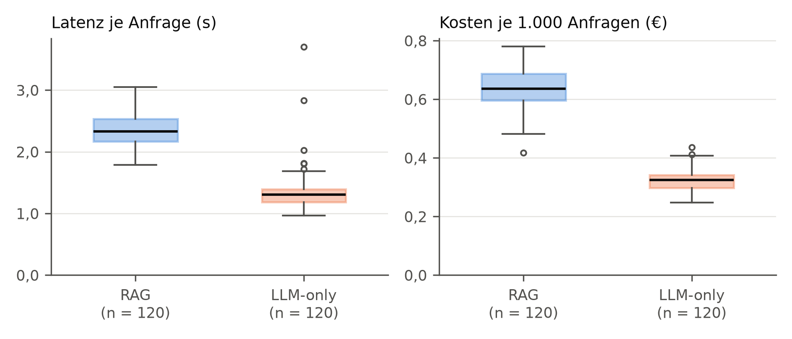

# Strang 1: Protokollierung – Lauf haupt-01

Erzeugt mit `auswertung/strang1.py` am 2026-10-20. Kosten in Euro umgerechnet mit dem EZB-Referenzkurs 1,1206 USD je Euro vom 2026-10-09.

## Datenqualität

- Einträge: 240 (120 Tickets × 2 Bedingungen), fehlgeschlagene Aufrufe laut errors.jsonl: 0
- Abbruchgrund der Generierung: LLM-only stop: 120, RAG stop: 120
- Modellversion laut Antwort: gpt-4.1-mini-2025-04-14 (240)
- verschiedene system_fingerprint-Werte: 4

## Tabelle: Tokenverbrauch, Kosten und Latenz je Anfrage

Median (Interquartilsbereich Q1–Q3); letzte Spalte: Median der Differenz RAG minus LLM-only je Ticket.

| Größe | RAG | LLM-only | Differenz (Median) |
| --- | --- | --- | --- |
| Input-Tokens | 1.160 (1.077–1.227) | 327 (309–346) | 818 |
| Output-Tokens | 158 (138–178) | 145 (131–156) | 17 |
| Embedding-Tokens | 69 (49–92) | 0 (0–0) | 69 |
| Kosten je 1.000 Anfragen (€) | 0,637 (0,596–0,688) | 0,325 (0,297–0,342) | 0,315 |
| Latenz gesamt (s) | 2,33 (2,17–2,53) | 1,31 (1,19–1,40) | 1,06 |
| davon Generierung (s) | 1,39 (1,26–1,56) | 1,31 (1,19–1,40) | 0,12 |
| davon Retrieval (s) | 0,92 (0,87–0,99) | 0,00 (0,00–0,00) | 0,92 |

## Kosten

- Mittlere Kosten je Anfrage: RAG 0,635 € je 1.000 Anfragen, LLM-only 0,322 € je 1.000 Anfragen (Faktor 1,97).
- **Variable Kosten je Ticket für Teilstudie B (RAG, Mittelwert): 0,000635 €** (0,635 € je 1.000 Tickets). Der Mittelwert ist hier die passende Größe, weil sich Kosten über das Ticketvolumen aufsummieren.

Gesamtkosten des Laufs haupt-01 (Summe über alle 240 protokollierten Aufrufe, Preisliste zum Stichtag):

| | RAG | LLM-only | gesamt |
| --- | --- | --- | --- |
| Generierung (USD) | 0,0852 | 0,0433 | 0,1285 |
| Embedding der Anfrage (USD) | 0,0002 | 0,0000 | 0,0002 |
| **gesamt** (USD) | 0,0854 | 0,0433 | 0,1287 |
| **gesamt (€)** | 0,0762 | 0,0387 | 0,1148 |

Nicht enthalten: Aufwärmaufruf vor dem Lauf, Pilotläufe, Indexierung der KB und Erzeugung von KB und Tickets (siehe `auswertung/api_nutzung.py`).

## Latenz der RAG-Bedingung nach Teilschritt (Median, s)

| Embedding | Vektorsuche | Reranking | Generierung | gesamt |
| --- | --- | --- | --- | --- |
| 0,14 | 0,01 | 0,76 | 1,39 | 2,33 |

90 % der RAG-Anfragen waren nach 2,72 s beantwortet, 90 % der LLM-only-Anfragen nach 1,55 s.

## Retrieval-Trefferquote (KB-gedeckte Tickets, n = 96)

Anteil der Tickets, deren Belegartikel (laut Musterantwort) unter den abgerufenen Artikeln waren. Ein Treffer heißt nicht, dass der passende Abschnitt übergeben wurde (vgl. F2 in der Kodierung).

| | mindestens ein Belegartikel | alle Belegartikel |
| --- | --- | --- |
| übergeben (Top-3 nach Reranking) | 95/96 (99,0 %) | 70/96 (72,9 %) |
| unter den Kandidaten (Top-5 der Vektorsuche) | 96/96 (100,0 %) | 79/96 (82,3 %) |

Nach Schwierigkeitsgrad (mindestens ein Belegartikel übergeben):

| Schwierigkeit | Treffer |
| --- | --- |
| einfach | 43/44 (97,7 %) |
| mittel | 32/32 (100,0 %) |
| komplex | 20/20 (100,0 %) |

