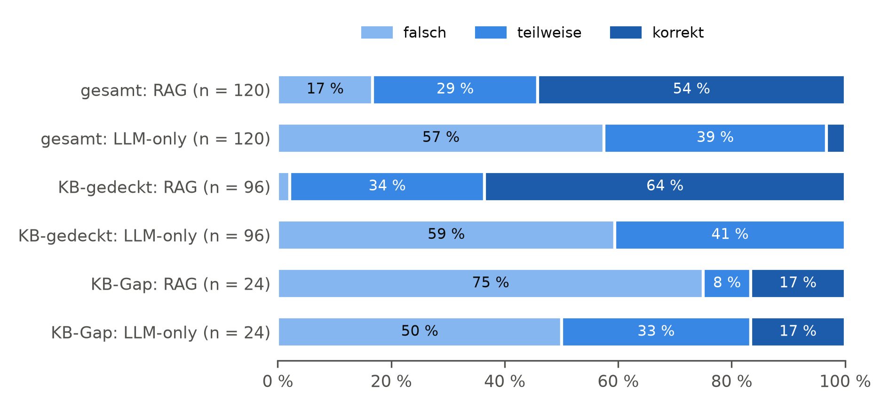
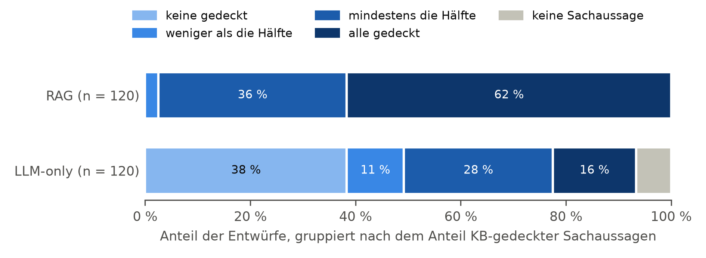

# Strang 2: Automatisierte Bewertung

Erzeugt mit `auswertung/strang2.py` am 2026-10-26. Judge-Lauf `haupt-01-j1` über Lauf `haupt-01`: Modell `claude-sonnet-5-5`, Prompt-Version v3, Effort medium, Konfiguration `3c1a9cb5a97898ab`. 120 Ticketpaare, alle Tests zweiseitig mit α = 0,05 (DEMI 1.4.5).

## H1: Referenzbasierte Korrektheit

Tabelle: Verteilung je Bedingung (n = 120 je Bedingung)

| Urteil | RAG | LLM-only |
| --- | --- | --- |
| korrekt | 65 (54,2 %) | 4 (3,3 %) |
| teilweise | 35 (29,2 %) | 47 (39,2 %) |
| falsch | 20 (16,7 %) | 69 (57,5 %) |
| Median (IQR) | korrekt (teilweise–korrekt) | falsch (falsch–teilweise) |

Tabelle: Paare (Zeilen RAG, Spalten LLM-only)

| RAG \ LLM-only | falsch | teilweise | korrekt |
| --- | --- | --- | --- |
| falsch | 10 | 7 | 3 |
| teilweise | 21 | 14 | 0 |
| korrekt | 38 | 26 | 1 |

- RAG besser: 85 Paare, gleich: 25, LLM-only besser: 10
- Exakter Wilcoxon-Vorzeichen-Rang-Test (n = 95 Paare mit Unterschied von 120): T+ = 4.142,5, p < 0,001, z = 7,15, r = 0,65 (groß)
- Robustheitsprüfung, Test auf marginale Homogenität nach Stuart und Maxwell: χ²(2) = 58,64, p < 0,001

## H3: KB-Supportedness

Anteil der Sachaussagen eines Entwurfs, die laut Judge durch die gesamte KB gedeckt sind. Entwürfe ohne Sachaussage haben keinen Wert und fallen paarweise aus (DEMI 2.3).

| | RAG | LLM-only |
| --- | --- | --- |
| Entwürfe ohne Sachaussage | 0 (0,0 %) | 8 (6,7 %) |
| Sachaussagen je Entwurf, Median (IQR) | 5 (4–6) | 2 (1–3) |
| KB-Supportedness, Median (IQR), Paare n = 112 | 1,00 (0,80–1,00) | 0,33 (0,00–0,67) |
| Mittelwert (ergänzend) | 0,89 | 0,38 |
| alle Sachaussagen gedeckt | 69 | 19 |
| keine Sachaussage gedeckt | 0 | 46 |

- RAG höher: 91 Paare, gleich: 16, LLM-only höher: 5
- Wilcoxon-Vorzeichen-Rang-Test, exakt (n = 96 von 112 Paaren): T+ = 4.564,5, p < 0,001, z = 8,20, r = 0,78 (groß)

## Untergruppen (deskriptiv)

Anteil korrekter Entwürfe und Paarvergleich der Korrektheit; Median der KB-Supportedness (Paare mit Werten).

| Gruppe | Ticketpaare | korrekt RAG | korrekt LLM-only | RAG besser / gleich / schlechter | KB-Supportedness RAG | LLM-only |
| --- | --- | --- | --- | --- | --- | --- |
| KB-Abdeckung: gedeckt | 96 | 64 % | 0 % | 81 / 14 / 1 | 1,00 | 0,50 |
| KB-Abdeckung: gap | 24 | 17 % | 17 % | 4 / 11 / 9 | 0,75 | 0,00 |
| Schwierigkeit: einfach | 44 | 91 % | 0 % | 43 / 1 / 0 | 1,00 | 0,50 |
| Schwierigkeit: mittel | 32 | 44 % | 0 % | 23 / 8 / 1 | 1,00 | 0,42 |
| Schwierigkeit: komplex | 20 | 35 % | 0 % | 15 / 5 / 0 | 1,00 | 0,50 |
| Schwierigkeit: kb_gap | 24 | 17 % | 17 % | 4 / 11 / 9 | 0,75 | 0,00 |
| Kategorie: Versand | 30 | 63 % | 3 % | 21 / 6 / 3 | 1,00 | 0,50 |
| Kategorie: Retoure | 30 | 67 % | 0 % | 22 / 6 / 2 | 1,00 | 0,33 |
| Kategorie: Reklamation/Garantie | 30 | 33 % | 3 % | 17 / 10 / 3 | 1,00 | 0,42 |
| Kategorie: Zahlung | 30 | 53 % | 7 % | 25 / 3 / 2 | 1,00 | 0,33 |

## Diagnosemetriken und Answer Relevance (beschreibend)

| Metrik | gilt für | n | Median (IQR) | Mittelwert |
| --- | --- | --- | --- | --- |
| RAG-Faithfulness | RAG | 120 | 0,86 (0,70–1,00) | 0,83 |
| Context Relevance | RAG | 120 | 0,67 (0,33–0,67) | 0,63 |
| Answer Relevance | RAG | 120 | 0,733 (0,698–0,770) | 0,732 |
| Answer Relevance | LLM-only | 120 | 0,774 (0,748–0,805) | 0,774 |

Faithfulness = 1 bei 57 von 120 RAG-Entwürfen. Context Relevance: Anteil der drei übergebenen Auszüge, die zur Beantwortung erforderlich sind.

## Stabilität des Judge (J-03)

24 Entwürfe (12 RAG, 12 LLM-only) in zwei Läufen mit identischer Konfiguration bewertet.

| Metrik | n | identisch | weitere Kennzahl |
| --- | --- | --- | --- |
| Korrektheit | 24 | 100,0 % | Cohens Kappa 1,00 |
| KB-Supportedness | 23 | 91,3 % | mittlere absolute Differenz 0,03 |
| RAG-Faithfulness | 12 | 83,3 % | mittlere absolute Differenz 0,03 |
| Context Relevance | 12 | 91,7 % | mittlere absolute Differenz 0,03 |
| Answer Relevance | 24 | – | mittlere absolute Differenz 0,017 |

