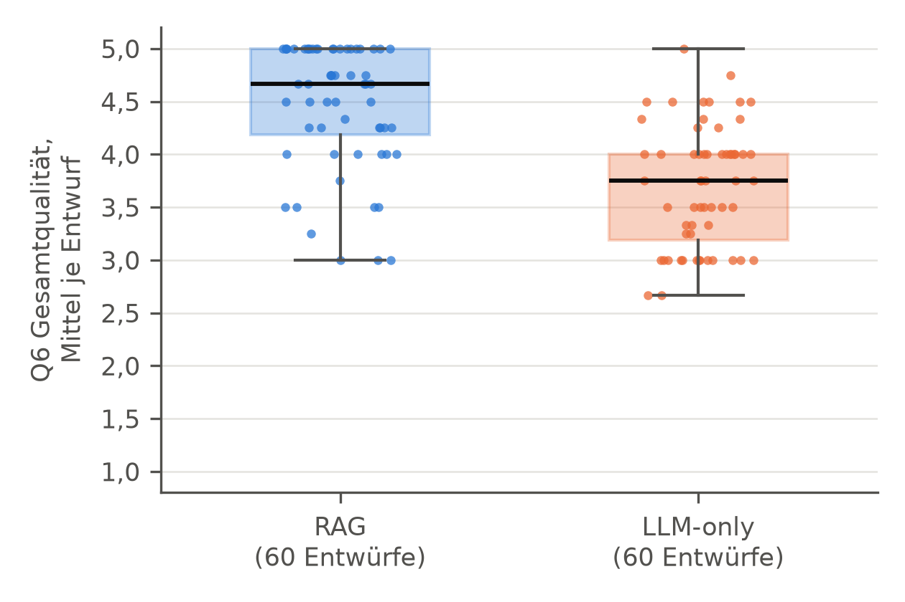
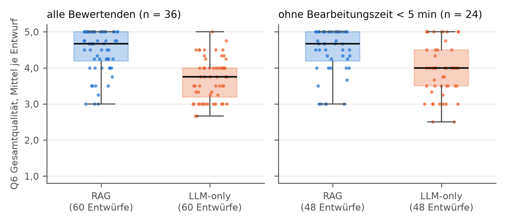
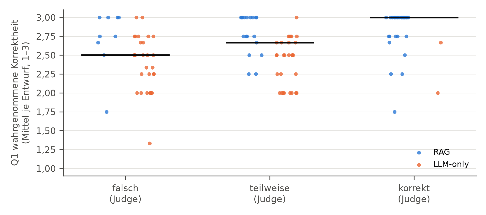

# Strang 3: Online-Befragung

Erzeugt mit `auswertung/strang3.py` am 2026-10-26. 36 vollständige Teilnahmen, 432 Bewertungen von 120 Entwürfen (60 Ticketpaare). Urteile je Entwurf gemittelt, alle Tests zweiseitig mit α = 0,05.

## Stichprobe

- Urteile je Entwurf: 3 Urteile bei 48 Entwürfen, 4 Urteile bei 72 Entwürfen
- Erfahrung im Kundenservice: 16 ja, 20 nein
- Bearbeitungszeit: Median 13,4 min (IQR 3,4–23,8), Minimum 2,2 min, Maximum 1.789,5 min
- Bearbeitungszeit unter 5 Minuten: 12 Personen (3 mit, 9 ohne Erfahrung im Kundenservice); Sensitivitätsanalyse ohne diese Personen (AW-07)

| Merkmal | Ausprägung | n |
| --- | --- | --- |
| S1 Altersgruppe | 20–29 | 22 |
| S1 Altersgruppe | 30–39 | 8 |
| S1 Altersgruppe | 50–59 | 3 |
| S1 Altersgruppe | 60 und älter | 3 |
| S2 Geschlecht | weiblich | 13 |
| S2 Geschlecht | männlich | 22 |
| S2 Geschlecht | divers | 1 |
| S3 Bildungsabschluss | Schulabschluss | 6 |
| S3 Bildungsabschluss | abgeschlossene Ausbildung | 16 |
| S3 Bildungsabschluss | Bachelor | 12 |
| S3 Bildungsabschluss | Master oder höher | 2 |
| S4 Erfahrung im Kundenservice | ja, aktuell | 10 |
| S4 Erfahrung im Kundenservice | ja, früher | 6 |
| S4 Erfahrung im Kundenservice | nein | 20 |
| S5 Nutzung von KI-Chatbots | täglich | 20 |
| S5 Nutzung von KI-Chatbots | wöchentlich | 9 |
| S5 Nutzung von KI-Chatbots | monatlich | 3 |
| S5 Nutzung von KI-Chatbots | seltener | 3 |
| S5 Nutzung von KI-Chatbots | nie | 1 |

Zuordnung der Codes zu den Antwortoptionen nach der Reihenfolge in FRAGEBOGEN.md (Qualtrics, Export values).

## H2: Gesamtqualität (Q6)

| | alle Bewertenden | ohne Bearbeitungszeit < 5 min |
| --- | --- | --- |
| Personen | 36 | 24 |
| Ticketpaare | 60 | 48 |
| Q6 RAG, Median (IQR) | 4,67 (4,19–5,00) | 4,67 (4,19–5,00) |
| Q6 LLM-only, Median (IQR) | 3,75 (3,19–4,00) | 4,00 (3,50–4,50) |
| RAG höher / gleich / LLM-only höher | 50 / 2 / 8 | 32 / 6 / 10 |
| Wilcoxon (exakt) | T+ = 1.557,0, p < 0,001 | T+ = 729,0, p < 0,001 |
| z, Effektstärke r | z = 5,44, r = 0,70 (groß) | z = 3,48, r = 0,50 (groß) |

In der Sensitivitätsanalyse entfallen 12 Ticketpaare, weil alle Bewertenden ihres Blocks unter 5 Minuten lagen.

## Items Q1–Q6 je Bedingung (beschreibend)

Mittelwerte der Urteile je Entwurf; Median (IQR) über die 60 Entwürfe je Bedingung.

| Item | RAG | LLM-only | Differenz der Mediane |
| --- | --- | --- | --- |
| Q1 Korrektheit (wahrgenommen, 1–3) | 3,00 (2,75–3,00) | 2,50 (2,00–2,67) | 0,50 |
| Q2 Vollständigkeit | 5,00 (4,31–5,00) | 4,00 (3,75–4,50) | 1,00 |
| Q3 Verständlichkeit | 4,75 (4,46–5,00) | 4,33 (4,00–4,54) | 0,42 |
| Q4 Ton | 4,75 (4,50–5,00) | 4,75 (4,50–5,00) | 0,00 |
| Q5 ohne Änderung sendbar | 4,75 (4,19–5,00) | 3,75 (3,33–4,25) | 1,00 |
| Q6 Gesamtqualität | 4,67 (4,19–5,00) | 3,75 (3,19–4,00) | 0,92 |

## Übereinstimmung der Bewertenden (ICC)

Zwei-Weg-Zufallsmodell, absolute Übereinstimmung; Varianzkomponenten aus einem linearen gemischten Modell mit gekreuzten Zufallseffekten für Entwurf und Person (DEMI 2.4). Einordnung nach Koo und Li (2016).

| Item | ICC(2,1) | ICC(2,3) | Einordnung ICC(2,3) | σ² Entwurf | σ² Person | σ² Rest |
| --- | --- | --- | --- | --- | --- | --- |
| Q1 Korrektheit (wahrgenommen, 1–3) | 0,29 | 0,55 | mäßig | 0,088 | 0,039 | 0,175 |
| Q2 Vollständigkeit | 0,17 | 0,38 | gering | 0,126 | 0,224 | 0,394 |
| Q3 Verständlichkeit | 0,15 | 0,34 | gering | 0,090 | 0,155 | 0,376 |
| Q4 Ton | 0,08 | 0,21 | gering | 0,039 | 0,168 | 0,287 |
| Q5 ohne Änderung sendbar | 0,28 | 0,54 | mäßig | 0,287 | 0,119 | 0,610 |
| Q6 Gesamtqualität | 0,29 | 0,56 | mäßig | 0,304 | 0,206 | 0,524 |

Sensitivitätsanalyse Q6 ohne Bearbeitungszeit < 5 min: ICC(2,1) = 0,19, ICC(2,3) = 0,42.

## Bewertende mit und ohne Erfahrung im Kundenservice

Analyseeinheit ist die Person (AW-08): mittlere Gesamtqualität (Q6) über ihre zwölf Entwürfe und ihr wahrgenommener RAG-Vorteil (Mittel Q6 RAG minus Mittel Q6 LLM-only, je sechs Entwürfe).

| Kennzahl | mit Erfahrung (n = 16) | ohne Erfahrung (n = 20) | Mann-Whitney-U |
| --- | --- | --- | --- |
| Q6 gesamt, Median (IQR) | 4,25 (3,94–4,50) | 4,00 (3,96–4,17) | U = 207,0, p = 0,137, r = 0,25 |
| RAG-Vorteil in Q6, Median (IQR) | 0,08 (−0,21–0,38) | 1,50 (0,13–1,88) | U = 86,0, p = 0,019, r = 0,39 |

Unter den 12 Personen mit Bearbeitungszeit unter 5 Minuten haben 9 keine Erfahrung im Kundenservice; der Gruppenvergleich ist damit mit der Bearbeitungszeit vermengt. Ohne diese Personen: RAG-Vorteil mit Erfahrung (n = 13) 0,00 (−0,33–0,33), ohne Erfahrung (n = 11) 0,17 (−0,08–1,08); U = 53,0, p = 0,295, r = 0,22.

## H6: Zusammenhang von menschlicher und automatisierter Bewertung

Spearmans ρ über die bewerteten Entwürfe (beide Bedingungen); 95-%-Konfidenzintervall per Bootstrap (10.000 Ziehungen, fester Seed).

| Zusammenhang | n | ρ | 95-%-KI | p |
| --- | --- | --- | --- | --- |
| **Q1 wahrgenommene Korrektheit – Korrektheit (Judge)** | 120 | 0,40 | 0,23 bis 0,56 | p < 0,001 |
| dasselbe ohne Bearbeitungszeit < 5 min | 108 | 0,29 | 0,10 bis 0,47 | p = 0,002 |
| Q6 Gesamtqualität – Korrektheit (Judge) (ergänzend) | 120 | 0,42 | 0,27 bis 0,56 | p < 0,001 |
| Q6 Gesamtqualität – KB-Supportedness (ergänzend) | 115 | 0,37 | 0,20 bis 0,52 | p < 0,001 |
| Q2 Vollständigkeit – Answer Relevance (ergänzend) | 120 | −0,23 | −0,40 bis −0,04 | p = 0,012 |

Innerhalb der Bedingungen (ergänzend; zeigt, ob der Zusammenhang nur aus dem Bedingungsunterschied entsteht): RAG ρ = 0,22 (p = 0,097, n = 60); LLM-only ρ = 0,02 (p = 0,904, n = 60).

Mittelwert Q1 je Korrektheitsurteil des Judge:

| Judge | n | Q1, Median (IQR) |
| --- | --- | --- |
| korrekt | 35 | 3,00 (2,75–3,00) |
| teilweise | 47 | 2,67 (2,25–2,75) |
| falsch | 38 | 2,50 (2,25–2,75) |

## Untergruppen (deskriptiv)

Q6 je Entwurf, Median nach Bedingung; Paarvergleich der Mittelwerte.

| Gruppe | Ticketpaare | Q6 RAG | Q6 LLM-only | RAG höher / gleich / niedriger |
| --- | --- | --- | --- | --- |
| KB-Abdeckung: gedeckt | 48 | 4,71 | 3,75 | 41 / 1 / 6 |
| KB-Abdeckung: gap | 12 | 4,46 | 3,75 | 9 / 1 / 2 |
| Schwierigkeit: einfach | 20 | 4,67 | 3,88 | 18 / 1 / 1 |
| Schwierigkeit: mittel | 16 | 4,88 | 3,75 | 13 / 0 / 3 |
| Schwierigkeit: komplex | 12 | 4,62 | 3,29 | 10 / 0 / 2 |
| Schwierigkeit: kb_gap | 12 | 4,46 | 3,75 | 9 / 1 / 2 |
| Kategorie: Versand | 15 | 4,75 | 4,00 | 13 / 1 / 1 |
| Kategorie: Retoure | 15 | 4,50 | 3,75 | 12 / 0 / 3 |
| Kategorie: Reklamation/Garantie | 15 | 4,50 | 4,00 | 13 / 0 / 2 |
| Kategorie: Zahlung | 15 | 4,75 | 3,50 | 12 / 1 / 2 |

