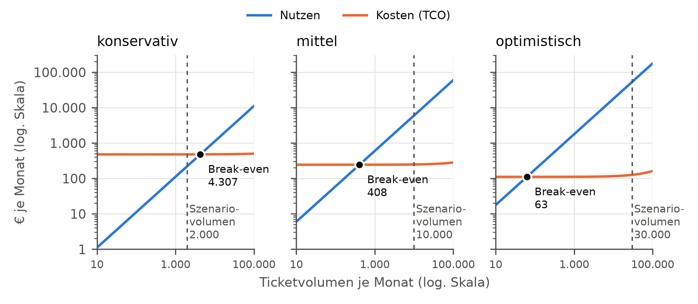
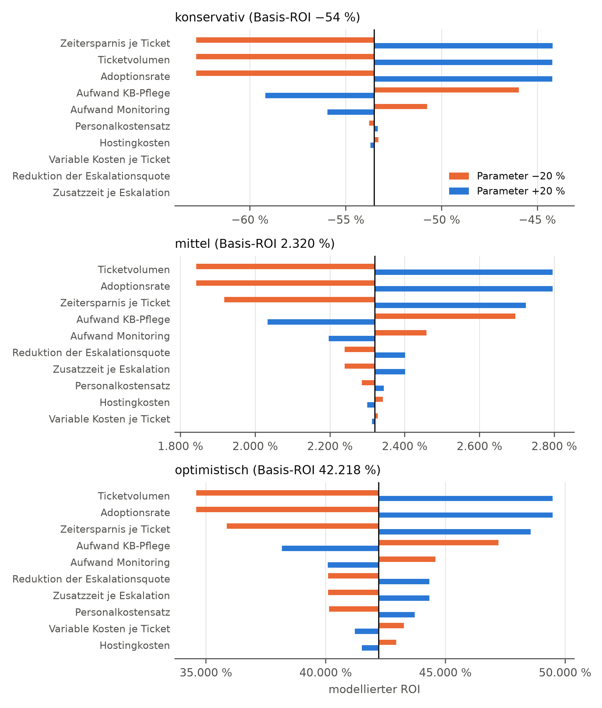
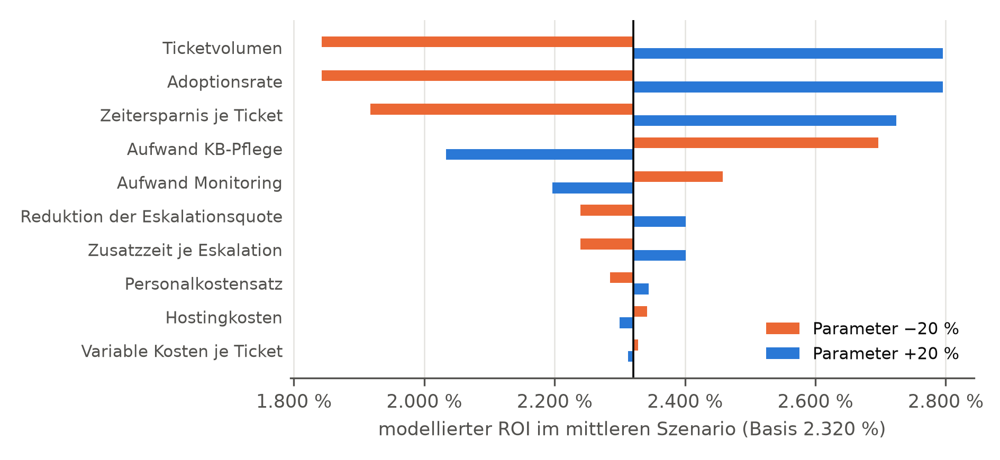

# Teilstudie B: ROI/TCO-Modell

Erzeugt mit `auswertung/teilstudie_b.py` am 2026-10-26. **Alle Werte sind Modellergebnisse und keine empirischen Messwerte** (DEMI 1.5). Gemessen sind nur die variablen Kosten je Ticket und für die Schwelle RAG gegenüber LLM-only die Latenzdifferenz (Strang 1); alle übrigen Eingangsgrößen sind Sekundärdaten oder Annahmen. Beträge netto, je Monat.

## Eingangsgrößen

| Parameter | Einheit | Typ | konservativ | mittel | optimistisch |
| --- | --- | --- | --- | --- | --- |
| Ticketvolumen je Monat | Tickets | Annahme | 2.000 | 10.000 | 30.000 |
| Adoptionsrate | Anteil der Tickets | Annahme | 40 % | 60 % | 80 % |
| Zeitersparnis je unterstütztem Ticket | min | Annahme | 0,5 | 1,5 | 3,0 |
| Personalkostensatz | €/h | Sekundärdaten | 33,20 | 33,20 | 33,20 |
| Reduktion der Eskalationsquote | Prozentpunkte | Annahme | 0 | 2 | 5 |
| Zusatzzeit je Eskalation | min | Annahme | 10 | 15 | 20 |
| Variable Kosten je Ticket (RAG) | € | Messwert | 0,000635 | 0,000635 | 0,000635 |
| Serverpreis Hetzner CX33 (4 vCPU, 8 GB RAM, 80 GB) | €/Monat | Sekundärdaten | 8,49 | 8,49 | 8,49 |
| Primäre IPv4-Adresse | €/Monat | Sekundärdaten | 0,50 | 0,50 | 0,50 |
| Backup-Aufschlag | Anteil am Serverpreis | Sekundärdaten | 20 % | 20 % | 20 % |
| Aufwand KB-Pflege | h/Monat | Annahme | 10 | 5 | 2 |
| Aufwand Monitoring | h/Monat | Annahme | 4 | 2 | 1 |
| Variable Kosten je Ticket (LLM-only) | € | Messwert | 0,000322 | 0,000322 | 0,000322 |
| Latenzdifferenz RAG minus LLM-only | s | Messwert | 1,02 | 1,02 | 1,02 |

Quellen und Begründungen: `auswertung/README.md`, Entscheidungen B-01 bis B-09.

## Tabelle: Monatlicher Nutzen, Kosten und ROI je Szenario

| Größe | konservativ | mittel | optimistisch |
| --- | --- | --- | --- |
| Unterstützte Tickets | 800 | 6.000 | 24.000 |
| Nutzen aus Zeitersparnis | 221,33 € | 4.980,00 € | 39.840,00 € |
| Nutzen aus vermiedenen Eskalationen | 0,00 € | 996,00 € | 13.280,00 € |
| **Nutzen gesamt** | 221,33 € | 5.976,00 € | 53.120,00 € |
| Hostingkosten | 10,69 € | 10,69 € | 10,69 € |
| KB-Pflege | 332,00 € | 166,00 € | 66,40 € |
| Monitoring | 132,80 € | 66,40 € | 33,20 € |
| Variable Kosten (Tokens, Embeddings) | 0,51 € | 3,81 € | 15,24 € |
| **Kosten gesamt (TCO)** | 476,00 € | 246,90 € | 125,52 € |
| **Nettonutzen** | −254,66 € | 5.729,10 € | 52.994,48 € |
| **Modellierter ROI** | −54 % | 2.320 % | 42.218 % |
| Anteil variable Kosten an den Kosten | 0,11 % | 1,54 % | 12,14 % |

## Break-even

Ticketvolumen je Monat, ab dem der Nutzen die Kosten deckt (übrige Parameter auf dem Szenariowert; aufgerundet auf ganze Tickets). Das Modell ist im Ticketvolumen linear; der Wert wird daher geschlossen berechnet und entspricht dem Ergebnis der Zielwertsuche (B-06).

| | konservativ | mittel | optimistisch |
| --- | --- | --- | --- |
| Break-even-Ticketvolumen | 4.307 | 408 | 63 |
| angenommenes Ticketvolumen | 2.000 | 10.000 | 30.000 |
| Break-even erreicht | nein | ja | ja |

## Amortisationssicht (Ergänzung, B-08)

Höchste einmalige Investition (Einführung, Integration, Schulung), die der monatliche Nettonutzen in der jeweiligen Frist zurückverdient; ohne Abzinsung.

| Frist | konservativ | mittel | optimistisch |
| --- | --- | --- | --- |
| 12 Monate | keine Amortisation | 68.749 € | 635.934 € |
| 24 Monate | keine Amortisation | 137.498 € | 1.271.867 € |
| 36 Monate | keine Amortisation | 206.248 € | 1.907.801 € |

## Schwelle RAG gegenüber LLM-only (Ergänzung, B-09)

Zusätzliche Zeitersparnis je unterstütztem Ticket, die RAG gegenüber LLM-only erbringen muss, damit sich Hosting, KB-Pflege und die höheren Tokenkosten tragen; zuzüglich der gemessenen Latenzdifferenz als Wartezeit.

| Größe | konservativ | mittel | optimistisch |
| --- | --- | --- | --- |
| Mehrkosten RAG je Monat | 342,94 € | 178,56 € | 84,59 € |
| Zeitersparnis zur Deckung der Mehrkosten (s/Ticket) | 46,5 | 3,2 | 0,4 |
| Latenzdifferenz (s/Ticket) | 1,02 | 1,02 | 1,02 |
| **Erforderliche zusätzliche Zeitersparnis (s/Ticket)** | 47,5 | 4,2 | 1,4 |

## Sensitivität (One-at-a-time, ±20 %)

Rangfolge nach der Spannweite des ROI zwischen −20 % und +20 %; alle übrigen Parameter auf dem Szenariowert.

| konservativ | mittel | optimistisch |
| --- | --- | --- |
| 1. Zeitersparnis je Ticket (19 Pp.) | 1. Ticketvolumen (953 Pp.) | 1. Ticketvolumen (14.881 Pp.) |
| 2. Ticketvolumen (19 Pp.) | 1. Adoptionsrate (953 Pp.) | 1. Adoptionsrate (14.881 Pp.) |
| 2. Adoptionsrate (19 Pp.) | 3. Zeitersparnis je Ticket (807 Pp.) | 3. Zeitersparnis je Ticket (12.696 Pp.) |
| 4. Aufwand KB-Pflege (13 Pp.) | 4. Aufwand KB-Pflege (663 Pp.) | 4. Aufwand KB-Pflege (9.056 Pp.) |
| 5. Aufwand Monitoring (5,2 Pp.) | 5. Aufwand Monitoring (261 Pp.) | 5. Aufwand Monitoring (4.490 Pp.) |
| 6. Personalkostensatz (0,5 Pp.) | 6. Reduktion der Eskalationsquote (161 Pp.) | 6. Reduktion der Eskalationsquote (4.232 Pp.) |
| 7. Hostingkosten (0,4 Pp.) | 6. Zusatzzeit je Eskalation (161 Pp.) | 6. Zusatzzeit je Eskalation (4.232 Pp.) |
| 8. Variable Kosten je Ticket (0,0 Pp.) | 8. Personalkostensatz (59 Pp.) | 8. Personalkostensatz (3.586 Pp.) |
| 9. Reduktion der Eskalationsquote (0,0 Pp.) | 9. Hostingkosten (42 Pp.) | 9. Variable Kosten je Ticket (2.056 Pp.) |
| 9. Zusatzzeit je Eskalation (0,0 Pp.) | 10. Variable Kosten je Ticket (15 Pp.) | 10. Hostingkosten (1.442 Pp.) |

Pp. = Prozentpunkte des ROI; gleiche Spannweite ergibt denselben Rang. Ticketvolumen und Adoptionsrate gehen nur als Produkt (unterstützte Tickets) in das Modell ein und wirken deshalb gleich stark; dasselbe gilt für Reduktion der Eskalationsquote und Zusatzzeit je Eskalation. Im konservativen Szenario ist die Reduktion der Eskalationsquote 0; beide Eskalationsparameter haben dort bei relativer Variation keine Wirkung.

Szenario mittel im Einzelnen:

| Parameter | ROI bei −20 % | ROI bei +20 % | Spannweite (Pp.) |
| --- | --- | --- | --- |
| Ticketvolumen | 1.842 % | 2.796 % | 953 |
| Adoptionsrate | 1.842 % | 2.796 % | 953 |
| Zeitersparnis je Ticket | 1.917 % | 2.724 % | 807 |
| Aufwand KB-Pflege | 2.696 % | 2.034 % | 663 |
| Aufwand Monitoring | 2.458 % | 2.197 % | 261 |
| Reduktion der Eskalationsquote | 2.240 % | 2.401 % | 161 |
| Zusatzzeit je Eskalation | 2.240 % | 2.401 % | 161 |
| Personalkostensatz | 2.285 % | 2.344 % | 59 |
| Hostingkosten | 2.342 % | 2.300 % | 42 |
| Variable Kosten je Ticket | 2.328 % | 2.313 % | 15 |

